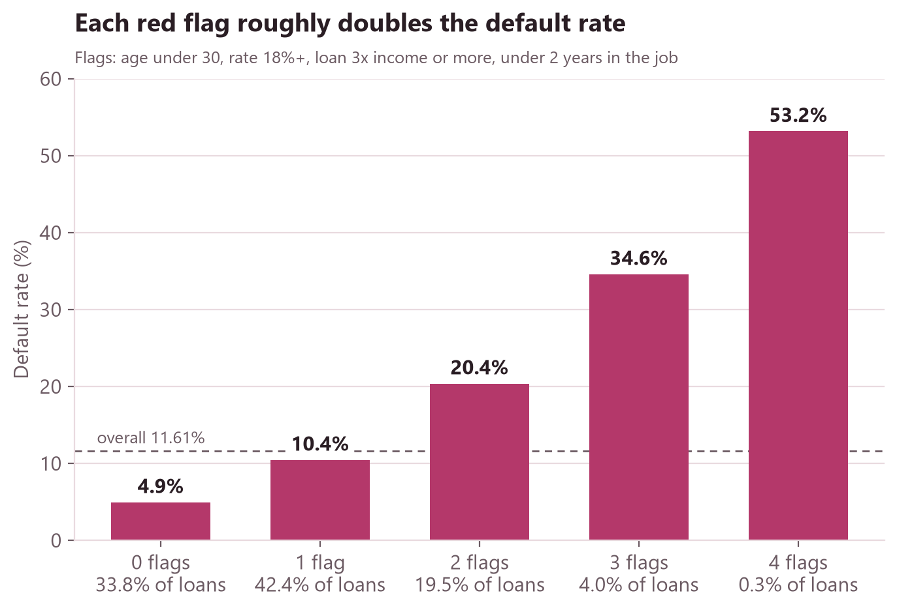
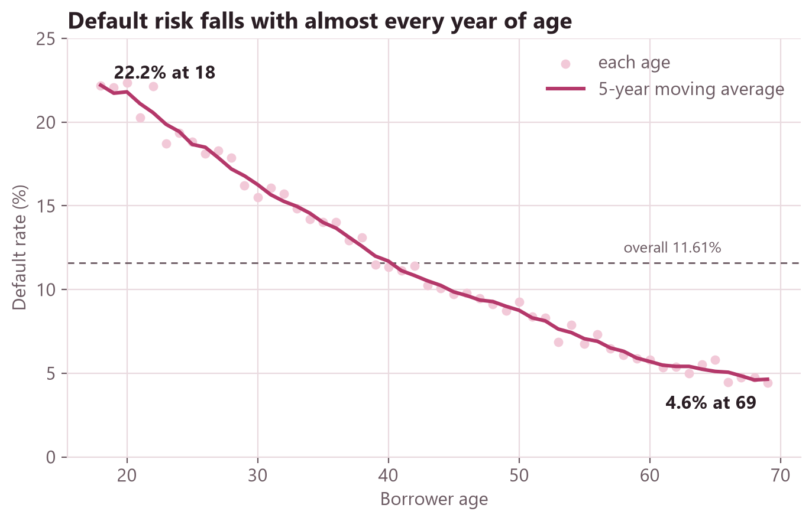
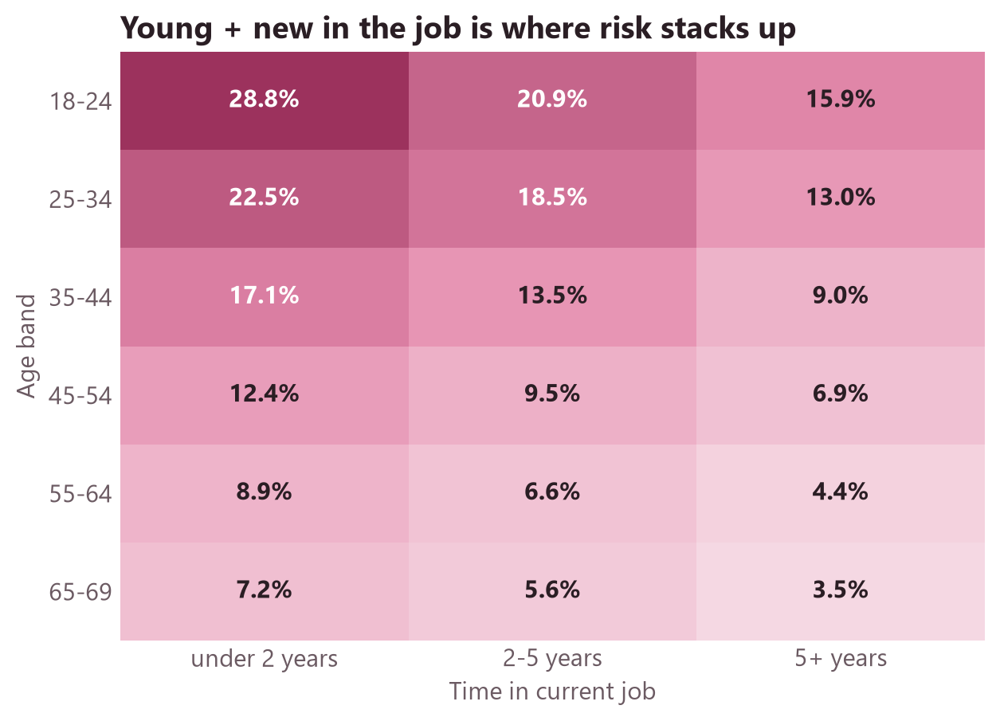
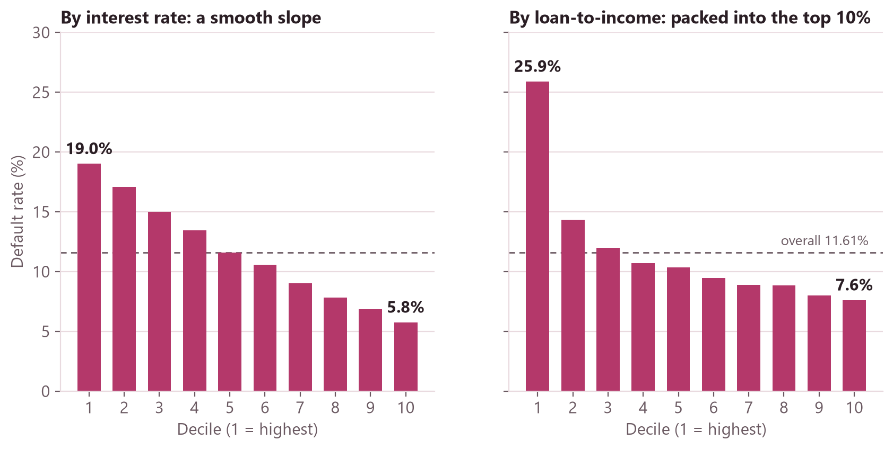

# Loan Default Risk in SQL

**Where does default risk sit in a 255,347-loan book, and how concentrated is it?** This is a SQL analysis in SQLite of the same Kaggle loan dataset I modelled in [loan-default-classification](https://github.com/syedahafsa135/loan-default-classification). That project asked *which model predicts default best*; this one asks *which borrowers default, in numbers a credit team can read*.

**Case study:** <https://syedahafsa135.github.io/projects/loan-default-sql.html>



## Key findings

1. **Four simple red flags separate risk sharply.** The flags are age under 30, interest rate 18%+, a loan 3× income or more, and under 2 years in the current job. With no flags, loans default at **4.94%**; each extra flag roughly doubles that, up to **53.17%** with all four. Loans with 2+ flags are **23.8%** of the book but hold **47.4%** of defaults.
2. **Age is the strongest single signal.** The 5-year moving average falls from **22.2%** at age 18 to **4.6%** at 69. Under 2 years in the job adds risk in every age band, most for the young: **28.78%** for 18–24s vs **3.47%** for 65–69s with 5+ years.
3. **Borrowing a lot relative to income matters, not low income.** Borrowers under 30k default at **21.96%**, but loans up to 2× income default at about **9%** in *every* income band. Defaults cluster in the top loan-to-income decile (4.8× income or more): **25.90%** default rate, **22.3%** of all defaults.
4. **Some "obvious" signals barely matter here.**
   - Loan term: **11.57–11.70%** for every term from 12 to 60 months.
   - Credit score: **13.67%** at 300–349 down to **9.81%** at 800+, with no cliff.
   - Loan purpose: Business is riskiest and Home safest in all four employment types, but the gaps are under 2 points.
5. **Risk is concentrated, not extreme.** Across 120 segments (age band × employment type × income band), the riskiest **40** hold half of all defaults while making up **28.6%** of loans. The top segment (18–24, unemployed, under 30k) defaults at **40.04%**.

| | |
|---|---|
|  |  |



## Data

- Kaggle **Loan Default Prediction Dataset**: 255,347 loans, 18 columns, 11.61% defaults (29,653).
- I used the cleaned file from Part 1 of my data science project. It is identical to the raw file except for two fixes: 17,274 `MonthsEmployed` values capped at (Age − 16) × 12, and apostrophes removed from Education.
- The audit found 0 duplicate IDs, 0 duplicate rows and 0 NULLs. Details are in [`notes.md`](notes.md).
- The data isn't committed. [`data/README.md`](data/README.md) explains how to get it.

## Caveats

- **No dates.** There is no origination date or loan status, so:
  - There is no volume-over-time view and no true vintage analysis.
  - We can't tell how long each loan has been running. Some loans labelled "not defaulted" may still be current and could default later ("current loans haven't had time to default"), so **11.61% is a floor**.
  - Window functions run over ordered bands (age, score, deciles) instead of time.
- **Likely synthetic.** Every category is split almost evenly, attributes are nearly uncorrelated, and half of borrowers are in the "Poor" credit band. The patterns are good for practising analysis, but shouldn't be read as how real borrowers behave.
- **Descriptive, not predictive.** The red-flag thresholds are round numbers I chose after looking at the data, so they are a rule of thumb, not a tested model. For tested models see [loan-default-classification](https://github.com/syedahafsa135/loan-default-classification) (best test AUC 0.740).
- **Fairness.** Age is the strongest signal, but age-based lending rules raise legal and fairness issues. Nothing here is a lending recommendation.

## What's in the SQL

Every query file opens with a comment header giving its **question**, the **SQL concepts** it uses, and the **takeaway**.

| File | Question | Concepts |
|---|---|---|
| [`01_audit.sql`](sql/01_audit.sql) | Is the raw table complete and unique? | `COUNT DISTINCT`, NULL checks, `UNION ALL` profiles |
| [`02_clean.sql`](sql/02_clean.sql) | Build the analysis table | `CREATE TABLE` with `PRIMARY KEY` / `CHECK`, `CASE` bands, indexes |
| [`03`](sql/03_basic_credit_band.sql)–[`06`](sql/06_basic_purpose_employment.sql) | Default by credit band, income, term, purpose and employment | `GROUP BY`, `HAVING`, conditional aggregation |
| [`07_adv_age_moving_average.sql`](sql/07_adv_age_moving_average.sql) | How does risk change with age? | Moving average (`ROWS BETWEEN`), `LAG` |
| [`08_adv_credit_score_lag.sql`](sql/08_adv_credit_score_lag.sql) | Is there a credit-score cliff? | `LAG`, running `SUM() OVER` |
| [`09_adv_ntile_deciles.sql`](sql/09_adv_ntile_deciles.sql) | How much risk sits in the top deciles? | `NTILE(10)`, gains table |
| [`10_adv_rank_partition.sql`](sql/10_adv_rank_partition.sql) | Riskiest purpose within each employment type | `RANK() OVER (PARTITION BY)` |
| [`11_adv_cte_scorecard.sql`](sql/11_adv_cte_scorecard.sql) | Does a count of red flags separate risk? | Multi-step CTEs |
| [`12_adv_cohort_matrix.sql`](sql/12_adv_cohort_matrix.sql) | Age × job tenure cohorts | Pivot with conditional aggregation |
| [`13_adv_pareto_segments.sql`](sql/13_adv_pareto_segments.sql) | How few segments hold half the defaults? | `DENSE_RANK`, running totals |
| [`14_view_dashboard.sql`](sql/14_view_dashboard.sql) | One flat table for Power BI | `CREATE VIEW` |

Every result is saved as a CSV in [`results/`](results/).

## Validation

[`src/validate.py`](src/validate.py) recomputes five results in pandas, straight from the CSV rather than the database. All five match:

- the overall rate
- rates by employment type
- interest-rate deciles
- the scorecard
- the Pareto count

One difference is worth knowing about. pandas' `qcut` makes slightly different deciles from SQL's `NTILE`, because `qcut` keeps tied values together and `NTILE` splits by row count. [`notes.md`](notes.md) explains this.

## How to run

```bash
git clone https://github.com/syedahafsa135/loan-default-sql.git
cd loan-default-sql
pip install -r requirements.txt
# put Loan_default.csv in data/ (see data/README.md), then:
python src/prepare_data.py          # raw -> cleaned CSV
python src/load_data.py             # cleaned CSV -> data/loans.db (loans_raw)
python src/run_sql.py --all         # runs sql/01 ... sql/14, writes results/*.csv
python src/validate.py              # pandas cross-check
python src/make_figures.py          # charts in figures/
python src/export_powerbi.py        # powerbi/loans_dashboard.csv for the dashboard
```

To explore by hand, open `data/loans.db` in [DB Browser for SQLite](https://sqlitebrowser.org/) and paste any query from `sql/` into the **Execute SQL** tab.

The Power BI page is built from `powerbi/loans_dashboard.csv`. [`powerbi/POWERBI_STEPS.md`](powerbi/POWERBI_STEPS.md) has the build steps and the values each visual should show.

## Limitations and next steps

- With a dataset that has origination dates (for example Lending Club), add a true vintage analysis and a volume trend using `LAG` over quarters.
- Test the red-flag rule on a held-out split instead of the data it was chosen on.
- Port the queries to PostgreSQL. The SQL is standard apart from SQLite's `(a < b)` returning 0/1.

---

Author: Syeda Hafsa · [Portfolio](https://syedahafsa135.github.io/) · [LinkedIn](https://www.linkedin.com/in/syeda-hafsa-140324224)
